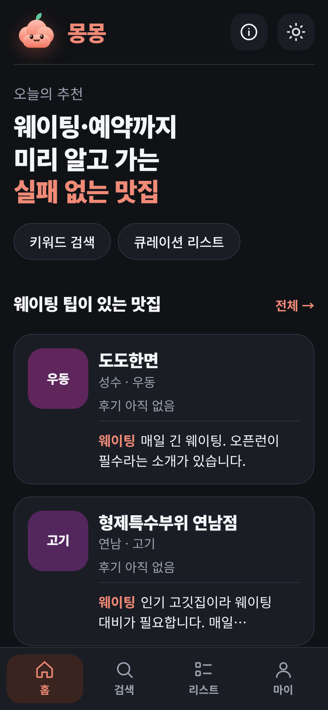
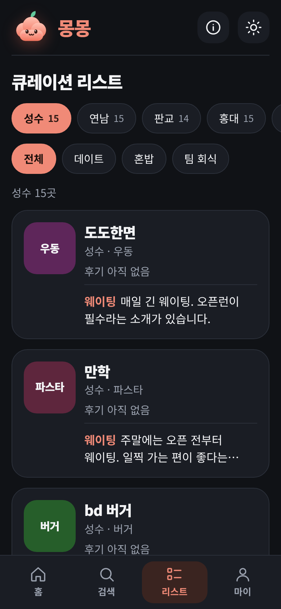
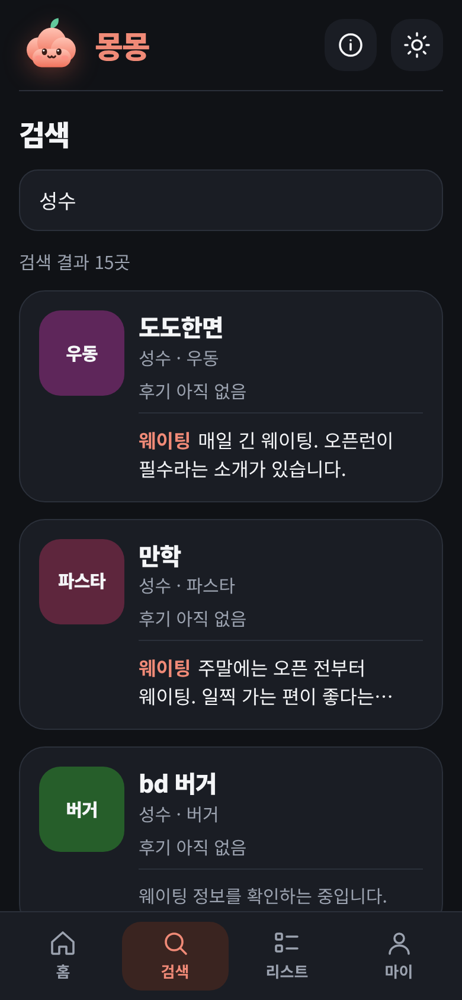
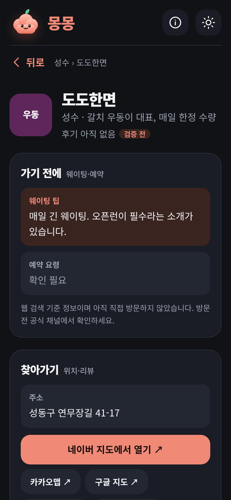
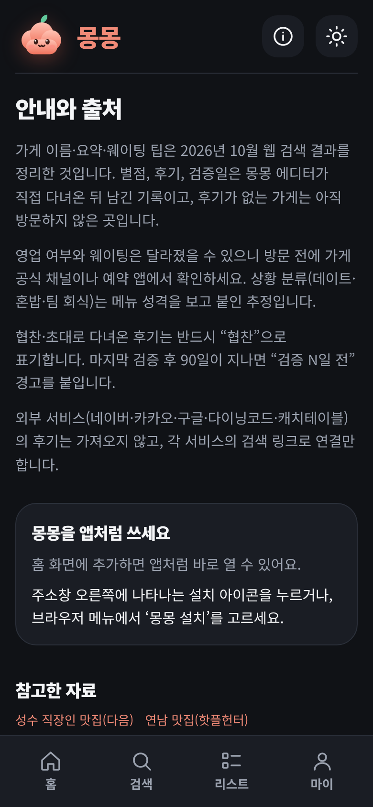
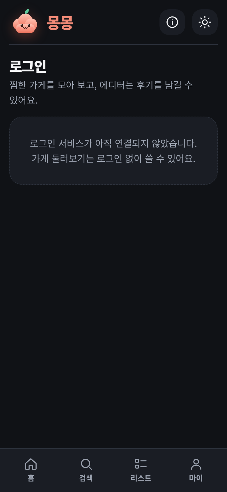

# 몽몽 — 지금까지 만든 것 (2026-10-21)

> 웨이팅 팁과 예약 요령까지 담은, 직접 다녀온 사람이 검증하는 동네 맛집 큐레이션 앱.
> 화면은 모바일 폭(390px) 실제 앱을 캡처한 것입니다. (`img/` 폴더)

## 한눈에 보기
| 항목 | 상태 |
|------|------|
| 기획 문서 (`docs/` 7종) | 완료 |
| 웹앱 읽기 기능 (홈·리스트·검색·상세·안내) | 완료, 시드 201곳·14개 동네로 동작 |
| 쓰기 기능 (로그인·후기·가게·사진·찜) | 구현·가짜 서버 시험 완료, **실제 Supabase 연결 시험 전** |
| DB 스키마·접근 규칙(RLS) | 로컬 Postgres로 검증 통과 |
| PWA (홈 화면 설치, 오프라인 화면) | 완료 |
| 접근성 점검(axe) | 위반 0건 |
| 보안 점검 | 운영 의존성 취약점 0건, 보안 헤더 적용 |
| 테스트 | 단위 108개(shared 37 · web 71), 브라우저 여정, RLS 검증 통과 |
| 배포 | **아직 안 함** — 순서는 `docs/07-배포-가이드.md` |

## 화면
| 홈 | 리스트 | 검색 | 가게 상세 |
|----|--------|------|-----------|
|  |  |  |  |

밝은 테마도 지원합니다. (`img/*-light.png`)

| 안내 | 로그인 |
|------|--------|
|  |  |

## 서비스 규칙(신뢰 장치)
- 후기가 없으면 **"검증 전"**, 90일이 지나면 **"검증 N일 전"**으로 표시합니다.
- 협찬 후기는 반드시 표기합니다.
- 외부 서비스의 리뷰·사진은 가져오지 않고 링크로만 연결합니다. 사진은 직접 올린 것만 씁니다.
- 후기는 에디터만 쓰고, 회원은 찜을 할 수 있습니다.

## 기술 구성
- 웹: Next.js 16 + TypeScript + Tailwind CSS 4 (Cache Components)
- 백엔드: Supabase (Postgres·Auth·Storage), 접근 제어는 DB의 RLS가 기준
- 공유 로직: `packages/shared` (이후 React Native 앱과 공유)
- 배포 예정: Vercel + Supabase

## 폴더
```
docs/               기획 문서 7종 (개요·역할·기능·화면·데이터 모델·로드맵·배포 가이드)
apps/web/           Next.js 웹앱
packages/shared/    타입·검증·통계 계산 (테스트 포함)
supabase/           스키마·RLS·시드·RLS 검증 SQL
scripts/            시드 생성, DB·브라우저·접근성 검증
outputs/            프로토타입(curation-map)과 이 현황 자료
```

## 다음 단계
1. Supabase 프로젝트 만들고 마이그레이션·시드 실행
2. Vercel 배포 (환경 변수 3개)
3. 첫 관리자 지정 → 실제 로그인·후기·사진 시험
4. 이후: React Native(Expo) 앱, 지도 API, 소셜 로그인
